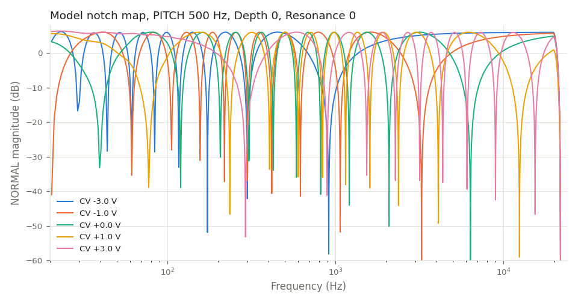
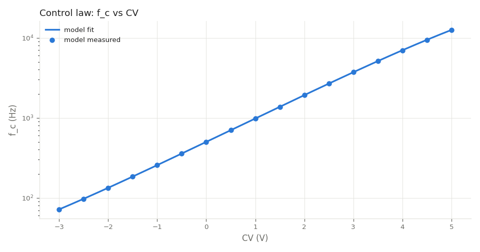
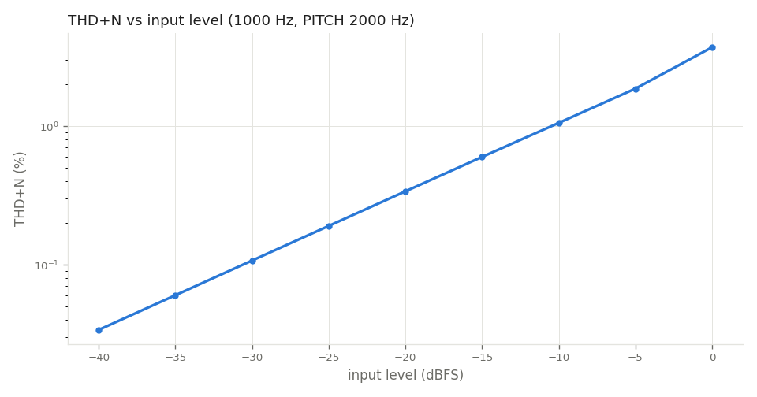
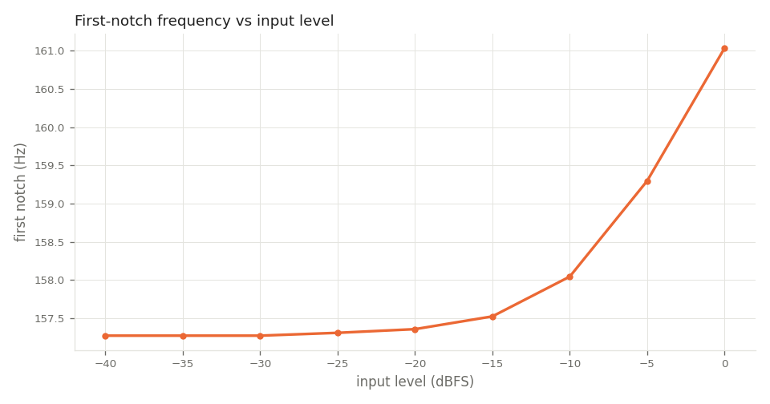
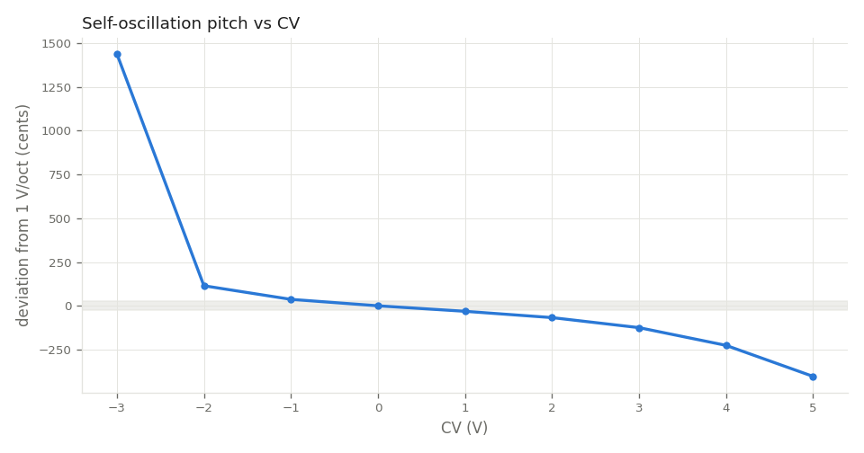
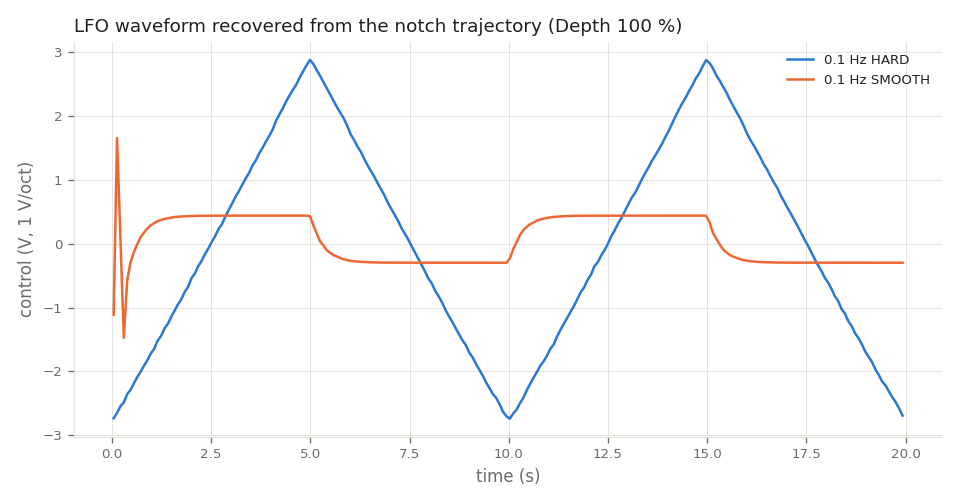

# Results notebook (model)

Generated by `measure/run_all.py` from the **model only**. Hardware columns are filled by `measure/compare.py` once
captures from a Random*Source Tau Phaser exist in `measure/data/hardware/` (see `docs/measurement_protocol.md`).
All tunables at their nominal defaults (`resources/tunables.json`).

## Notch map (Depth 0, Resonance 0, PITCH 500 Hz)

| CV (V) | notches < 20 kHz | fitted f_c (Hz) | fit error vs ideal tan law |
|---|---|---|---|
| -3.0 | 7 | 72.0 | 0.37 % |
| -1.0 | 9 | 257.0 | 0.45 % |
| +0.0 | 10 | 501.6 | 0.58 % |
| +1.0 | 10 | 982.9 | 0.39 % |
| +3.0 | 9 | 3717.2 | 0.23 % |

First notch set at CV 0: 39.7, 120.2, 207.0, 306.6, 427.6, 586.6, 818.2, 1211.2, 2090.1, 6372.9 Hz

## Control law

Fitted: f_ref 495.44 Hz, 1.0019 V/oct, 1/x saturation 61243 Hz, floor 9.86 Hz; max fit error 0.318 %.

## Level dependence / THD+N (1 kHz, PITCH 2 kHz, INPUT 0 dB)

 

| input (dBFS) | THD+N (%) | H2..H5 (dB re fundamental) | first notch (Hz) |
|---|---|---|---|
| -40 | 0.0339 | -69.4, -127.4, -163.9, -170.6 | 157.27 |
| -35 | 0.0603 | -64.4, -117.2, -167.4, -166.7 | 157.27 |
| -30 | 0.1072 | -59.4, -107.3, -157.0, -170.8 | 157.27 |
| -25 | 0.1905 | -54.4, -97.3, -142.1, -170.6 | 157.31 |
| -20 | 0.3383 | -49.4, -87.3, -126.7, -163.0 | 157.36 |
| -15 | 0.5991 | -44.5, -77.5, -112.0, -146.4 | 157.52 |
| -10 | 1.0542 | -39.5, -67.9, -97.5, -126.4 | 158.04 |
| -5 | 1.8619 | -34.6, -59.1, -84.0, -108.6 | 159.30 |
| +0 | 3.7029 | -28.6, -52.0, -71.9, -92.6 | 161.04 |

First-notch shift from -40 to 0 dBFS: +2.39 %.

## Self-oscillation (PITCH 500 Hz)

Onset at Resonance 93 % (loop gain 1 at the winning mode; 100 / feedback.gain_max = 85 % before the loop-corner losses). Oscillates for CV [-1, 5] V at this PITCH; below that, mode 1 falls under the 8 Hz loop high-pass floor. The flattening above +1 V is the 1/x compression (control.fc_sat_hz).

| CV (V) | f0 (Hz) | vs 1 V/oct (cents) | level (dBFS) | H1..H5 (dB) |
|---|---|---|---|---|
| -3 | 23.1 | +1438.9 | -86.0 | 0.0, -61.6, -118.2, -121.4, -123.8 |
| -2 | 21.5 | +114.5 | -52.2 | 0.0, -5.0, -46.1, -72.2, -108.3 |
| -1 | 41.1 | +36.8 | -15.2 | 0.0, -10.2, -15.0, -29.1, -45.0 |
| +0 | 80.4 | +0.0 | -12.7 | 0.0, -11.5, -13.5, -25.9, -42.2 |
| +1 | 158.0 | -31.4 | -12.7 | 0.0, -11.4, -13.5, -25.9, -42.2 |
| +2 | 309.4 | -67.4 | -12.7 | 0.0, -11.4, -13.5, -25.9, -42.2 |
| +3 | 598.7 | -124.7 | -12.7 | 0.0, -11.3, -13.4, -25.8, -42.3 |
| +4 | 1129.4 | -225.9 | -12.7 | 0.0, -11.2, -13.3, -25.5, -42.3 |
| +5 | 2039.1 | -403.0 | -12.6 | 0.0, -11.2, -13.0, -24.8, -42.0 |

## LFO

| set rate (Hz) | SMOOTH | measured rate (Hz) | swing (V) | triangle residual |
|---|---|---|---|---|
| 0.1 | off | 0.100 | 2.77 | 1.3 % |
| 0.1 | on | 0.100 | 0.37 | 47.8 % |
| 1.5 | off | 1.500 | - | - |
| 1.5 | on | 1.500 | - | - |
| 25 | off | 25.000 | - | - |
| 25 | on | 25.000 | - | - |

## Aliasing (0 dBFS tones, INPUT +6 dB, Resonance 80 %, engine Auto)

| tone | static worst non-harmonic (dBFS) | modulated worst non-sideband (dBFS) |
|---|---|---|
| 10000 Hz | None | -66.3 |
| 15000 Hz | None | -61.8 |

## CPU (arm64, 48 kHz, 64-sample blocks, one instance)

| engine | % of one core |
|---|---|
| 1x | 0.85 |
| 2x | 2.08 |
| 4x | 3.92 |
| 8x | 7.71 |
| auto (res 0) | 3.92 |

Algorithmic latency: 0 samples (reported to the host as 0). The IIR oversampling filters add a minimum-phase group delay of about 5 samples at 48 kHz (measured in `tests/UnitTests.cpp` T5).

## Engine study (spec 6 choices)

| engine rate factor | worst notch error vs analog tan law (PITCH 2 kHz) |
|---|---|
| 1x | 2.21 % over 9 notches |
| 2x | 0.56 % over 9 notches |
| 4x | 0.26 % over 9 notches |
| 8x | 0.23 % over 9 notches |

Coefficient update every 1 vs 8 engine samples (LFO 25 Hz, Depth 100 %): residual -36.84 dB.
Engine 1x vs 4x on modulated noise: residual 1.0 dB (the warp + oversampling difference).
Block-size independence (64 vs 4096): residual -400.0 dB.

## Acceptance vs hardware

Run `measure/compare.py` after the hardware captures exist; until then every 8.x item is **not measured**.
